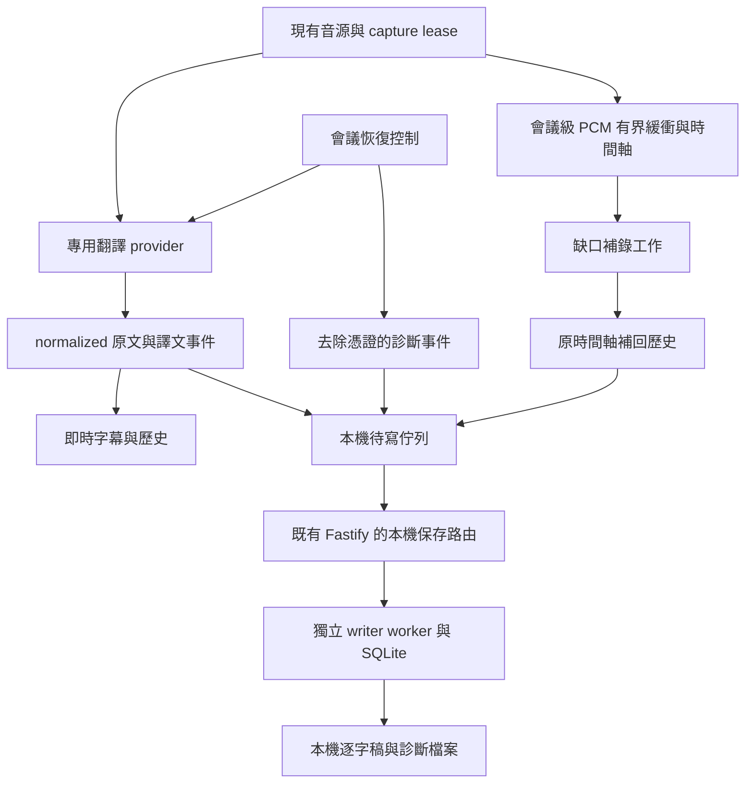

# 會議翻譯接續與本機自動保存藍圖

狀態：使用者要求徹查後重新開啟；追加原生音訊修復通過本機與正式 bundle 驗證，實際部署版本尚待核對。地端處理後排，真實服務與整體保存／完整度仍未驗收。日期：2026-10-02。
結果：[修復與驗證紀錄](../../MEETING_CONTINUITY_REPAIR_2026-10-02.md)。
依據：[診斷與嚴格複核](../../MEETING_CONTINUITY_DIAGNOSIS_2026-10-02.md)，尤其第 7 節。
工作清單：[分階段實作計畫](../plans/2026-10-02-meeting-continuity.md)。

## 1. 決策與範圍

最新執行順序：先修 Gemini／OpenAI 重連、候選與主線隔離、App 自動接管、Retry 歷史與音源所有權，
完成本機故障回歸及 Chrome 整合，再推進地端保存／補錄。對應任務見工作清單 R1–R5、L1–L2、V1。
下列完整架構仍是後續藍圖，不表示此輪已實作所有保存服務或音訊補錄。
工程目標是供應商正常換線及可恢復故障由程式自動處理；不能保證雲端永不斷線。
免費模擬驗證、預算核准的真 API 驗證、實際會議證據分開記錄，未測項目不冒充完成。

推薦沿用現有翻譯 provider、React、normalized events、Fastify，增補會議級恢復控制、
本機持久儲存與有界音訊緩衝。不是更換模型，也不是重寫整個產品。

**LOCAL 能完成的 LOG／TEXT 工作，一律由本機程式自動完成。**
保存、重試、去重、檔案輪替、恢復、查詢、匯出與缺口標示不使用雲端或 LLM。
雲端僅保留已選用的即時翻譯能力；已取得的文字不得因保存／整理再送雲端。

| 方案                                 | 優點                         | 關鍵缺點                                   | 決策       |
| ------------------------------------ | ---------------------------- | ------------------------------------------ | ---------- |
| 僅修 timer，加強瀏覽器快照           | 改動少                       | 無分會議可靠檔案、未解決漏音與錯誤接管     | 不足以達標 |
| 本機保存＋明確恢復控制＋短期音訊保全 | 對準已證實缺陷，重用現有能力 | 需提交確認、時間軸與失敗驗收               | 推薦       |
| 全程雙雲端模型並行／完整重寫         | 有機會縮短單家故障影響       | 成本、重複字幕與共同網路故障，仍需本機保存 | 不作預設   |

約束：

- 保持 `gemini-3.5-live-translate-preview`／`gpt-realtime-translate` 專用翻譯主體。
- LOG、原文、譯文預設自動本機保存；此為使用者明示要求，取代舊 opt-in 策略。
- 即時字幕不等待磁碟、補錄、匯出或摘要；失敗仍須立即可見。
- Online／Offline 隔離不變；無 KEY、外網斷線時本機保存仍可運作。
- 暫不增加摘要、互動助理、雲端備份、全程錄音、Electron 遷移。
- 不以文字相同判斷重複事件；不以 connected／字數取代內容恢復證據。

## 2. 系統責任與資料流

控制、顯示、持久保存互相獨立：UI store 是有界顯示快取，不是歷史資料庫。
保存事件在 store 淘汰舊段之前取得；新增一場會議只換顯示範圍，不刪舊資料。
單一會議一次只有一個 active writer；第二個分頁只讀，接管需釋放／到期租約。
服務不因沒有雲端 KEY 而停用保存 API；離線模式只使用 loopback 保存，不啟動雲端預熱。

## 3. LOCAL 儲存設計

### 3.1 位置、引擎與實際耐久性

- Windows 預設 `%LOCALAPPDATA%\MeetingAudio\`，不放 release、repo、temp 或自動同步目錄。
  提供 `MEETING_DATA_DIR` 明確覆寫；啟動顯示實際路徑與可寫性。
- `data/meetings.sqlite`：會議索引、原文／譯文修訂、缺口與提交紀錄。
- `logs/`：自動輪替 JSONL；`meetings/<meetingId>/`：本機自動產生 TXT／JSON 讀取副本。
  DB 為真實來源，匯出副本失敗不謊稱成功，恢復後可由 DB 重建。
- 初版採 SQLite＋單一 writer worker／單一 DB connection，`journal_mode=DELETE`、
  `synchronous=FULL`、參數化 SQL。讀取／匯出分頁也交同 worker，短交易避免阻塞寫入。
  commit 確認與檔案匯出確認分開，不把排隊成功當作保存成功。
- 暫不為尚未證實的讀寫併發需求開 WAL。未來若量測支持啟用，必須選已修復
  WAL-reset 問題的 SQLite（3.51.3+ 或官方指定修補分支），再驗 checkpoint／備份。
  SQLite 官方說明 WAL 應放本機檔案系統，FULL 與 NORMAL 的同步／耐久性不同；
  不能直接複製運行中的主 DB 當完整備份。
  [WAL](https://sqlite.org/wal.html)、[同步設定](https://sqlite.org/pragma.html#pragma_synchronous)。
- Node SQLite binding 由工作 T02 在實際發行 runtime 選定並鎖版，首選既有 runtime
  可支援的 `node:sqlite`，避免額外 native addon。不能只看 package.json 的 Node >=22：
  官方模組加入版本與同步 API 有明確限制，必須通過 worker／打包／崩潰測試。
  [Node SQLite](https://nodejs.org/api/sqlite.html)。不通過就於同一任務評估鎖版 binding，
  說明包裝成本；不得自製不具交易保證的 JSON 快照冒充完成。

### 3.2 寫入與復原

1. 原文、譯文、修訂、缺口各帶穩定 `eventId`、`meetingId`、writer／connection ID。
2. UI 立即更新；背景將事件放入 IndexedDB outbox，final 不合併丟棄。
   partial 以 segment＋revision 保留定期最新版本，不保存每字的所有中間變化。
3. 待寫佇列批次送 loopback API；同一事件重送使用相同 eventId。
4. DB 在同一 transaction 更新事件與查詢投影；只在 commit 成功後回傳已提交 eventId。
5. Browser 只刪除已確認項目；服務／瀏覽器重啟後重送，其唯一鍵防止重複。
6. 新 revision 不得被晚到舊 revision 覆寫；未完成句子保留 partial 標記，不假造 final。
7. 舊 localStorage／IDB 快照一次性匯入：先確認 DB 成功，再標記已遷移；不先刪資料。
8. TXT／JSON 在背景定期刷新，Stop 時完成最後刷新；使用同目錄暫存檔與原子替換，
   不在翻譯回呼中同步重寫整份逐字稿。

儲存狀態：`待保存 → 瀏覽器已暫存 → 本機已提交`；另顯示最後提交時間、待存筆數、
失敗原因及自動重試。DB 不可寫時字幕繼續，但整場「全部已保存」狀態撤回；
已成功提交的時間與筆數仍保留，不誤稱過去成功也失效。
若連瀏覽器暫存也失敗，記憶體佇列達界限後必須顯示明確未保存區間，不能默默丟棄。
非阻塞 UI 與任意瞬間斷電零損失無法一起無條件保證；提交前尾端窗口必須量測與揭露。

### 3.3 容量、維護與安全

- 會議內容預設不自動刪除；可由使用者明確刪除指定會議，不與 LOG 輪替共用政策。
- 診斷 LOG 初始建議上限 30 天或 512 MiB（先到者）；刪最舊已結束檔案，保留刪除摘要。
  此為可調規劃值，不代表現有設定。會議自身的故障／缺口摘要保存在 DB，隨會議保留。
- DB、交易日誌、outbox、匯出副本都列入容量監測；磁碟不足只報錯，不自動刪會議救空間。
- 採服務端固定資料根目錄、UUID 檔名、路徑穿越拒絕；保存 API 預設僅 loopback。
  即使服務設定為 LAN host，讀寫會議路由也不因此對 LAN 開放。
- 請求來源／本機會話授權檢查、body 大小限制與欄位白名單；CORS 不是唯一保護。
- 診斷只保存結構化原因／階段／計時／frame 計數，不保存 key、token、handle、原始 URL。
  原文／譯文只進會議內容儲存，不混入一般 request logger。

## 4. 會議恢復與切換

meetingId 在 Start 建立，Retry／GoAway／跨模型切換／重新開頁繼續時維持不變。
只有「新會議」建立新 ID；新 ID 也不得刪除舊資料。
session／connection generation 只管理一次 provider 活動，與 meetingId 分離。

| 情境                   | 控制行為                                            | 使用者看見                 |
| ---------------------- | --------------------------------------------------- | -------------------------- |
| 正常 GoAway            | 立即準備憑證與續接；依實測協定安排切點              | 預定換線，仍收音           |
| 硬斷線                 | 原模型立即有界恢復；PCM 保全                        | 正在重連、音訊已暫存       |
| 候選續期失敗、主線健康 | 保持主線並重試候選                                  | 背景續期異常，不報主線死亡 |
| 候選 transportReady    | 明確轉移音訊所有權，舊端有界收尾                    | 連線完成、等待翻譯         |
| 新連線收到有效輸出     | 清除該 generation 舊錯誤                            | 翻譯已恢復                 |
| 兩家都失敗             | 保留會議及收音，排有界重試，提供手動繼續            | 尚未恢復、缺口狀態可見     |
| 音源 ended             | 停止聲稱正在收音；保留已捕獲內容                    | 請重新選擇音源             |
| 使用者 Stop            | 取消所有候選／timer／補錄並釋放音源；保存已收到內容 | 已停止，顯示保存狀態       |

不能等待候選「第一段字幕」才開始送音，否則產生循環依賴。
transportReady 是轉送門檻，firstValidCaption 是 UX 與驗收門檻，兩者不同。
晚到舊連線文字只能修訂所屬舊段歷史，不能搶新 live caption；Stop 不等待雲端尾譯。
WebRTC 候選不得直接掛上共用 live track 後任其送音；先建立可協商的音訊 sender，
在採用候選時才 replaceTrack，或採等效且經實測支援的分離機制。
不得把共用 track.enabled=false 當候選靜音，否則會同時靜音健康主線。
若服務要求先送音才可完成 readiness，須明確量測有限重疊窗口與成本，修訂決策；
不能同時保證「零雙送音」又依賴候選先出字幕。

初始政策候選值（全部須 T10 實測調整，不是已達成承諾）：

- 2 秒僅提示，不自動 stop。原模型第一次重連立即開始，整次 mint＋握手總期限 12 秒。
- 真正不可用持續 4 秒可開始建立替代候選；不因此取消仍進行中的原模型嘗試。
  原模型先成功則取消候選；候選先 ready 才交接；同時最多一個候選，不全程雙送音。
- 預設「優先原模型，必要時自動備援」；提供「只用原模型」，該選項故障也必須保全音訊。
- 429 遵守 Retry-After；認證／配額／網路／resume 拒絕分類；不因非認證錯誤任意換 KEY。
- 每次 fetch 有 AbortSignal；Stop、generation 變更、總期限都取消。close 等待有期限，
  過期隔離舊 socket 後續接，不等無上限 onclose。
- watchdog 分 transport、audio captured/sent、原文／譯文進度；靜音與目標語言抑制輸出
  不當成無字幕故障。音量存在只是一項證據，不是「必須出譯文」的充分條件。
- Gemini 同 handle 是否允許候選並存以實驗決定；未證實前採先準備再切點、PCM 承接，
  不承諾 make-before-break／零空窗。OpenAI 只用 provider 支援的協商／整線續期方式。

## 5. 音訊保全與資訊完整性

- 重用 capture lease，加會議級 PCM tap；WebRTC 主傳輸不因緩衝而改成 WebSocket。
- 每軌依 sample index 建時間軸，記來源、sampleRate、capture epoch。重啟後新 epoch
  不假造與上一段連續；只有 wall clock 可對照時標示估計時間。
- 初始 RAM 環形緩衝 120 秒／軌，16 kHz mono PCM16 約 3.84 MB／軌；實際 heap 設界限。
  音源切換不混軌；收音與模型斷線無關。超出保全範圍的損失必須留缺口。
- 排補錄的範圍不能被 ring 覆寫後才讀取；須先取得受限快照或引用保護。
  初始 PCM 原始資料總額 16 MiB（含 ring、補錄快照、傳送副本），超限終止最舊未處理
  補錄並記不可補回範圍，不突破界限。metadata 與實際 heap 另行量測。
- 保存 captured／queued／send-attempted／dropped 計數；無供應商音訊 ACK 時
  不把 send 成功當「已處理」。疑似缺口保留重疊範圍，不捏造精確詞級對齊。
- 可補音訊與即時音訊分開排程；不把大量過去音訊灌進 live 令字幕永遠追不上。
- 自動重排文字／去重／匯出為純 LOCAL。缺口重新辨識需要 STT／翻譯能力：優先驗證
  現有離線管線能否完成，不能聲稱一般文字程式能還原沒有文字的語音。
  本方案不自動新增雲端補錄；若 local 能力不符品質／資源要求，保留缺口及失敗原因，
  補錄交付不算完成，另列能力缺口供決策。
- 補錄並行度 1、低優先、有界工作量；用時間區間＋segment lineage＋revision 合併，
  不因相同句子刪除真實重複。補回只進歷史與匯出，不蓋 live caption。
- RAM 音訊不承諾跨瀏覽器崩潰恢復，不自動永久錄音；譯文／LOG 的持久保存獨立成立。

## 6. 驗收與分階段交付

必達不變量：

1. Retry／切換不清除既有會議；新會議不覆寫舊會議。
2. 所有已確認提交的內容在程序被強制停止再啟動後仍存在，重送不重複。
3. 任何保存失敗可見，沒有假成功；LOCAL 保存測試不允許非 loopback 請求。
4. 候選失敗不停止健康主線；setupComplete 前不送 PCM，也不無聲丟掉該段。
5. 有界緩衝內捕獲音訊都有帳可查；超界、未捕獲、未辨識、未補回分別記錄。
6. 字幕 hot path 不 await persistence／recovery job；停機取消與晚到事件隔離成立。

量測目標（待 baseline 校準，不是無條件 SLO）：

| 指標                         | 初始驗收目標／判讀                                                              |
| ---------------------------- | ------------------------------------------------------------------------------- |
| 正常本機文字事件到 DB commit | P95 ≤1 秒；超過 2 秒可見待存，不偽造完成                                        |
| 保存錯誤提示                 | API 回報失敗後 ≤1 秒；掛住請求 ≤5 秒進入異常狀態                                |
| PCM 完整度                   | 緩衝容量內 100% 已捕獲 frames 被送出、排補錄或明確列損失；不冒充辨識正確率      |
| 硬斷線到首有效譯文           | 首輪目標 P95 ≤8 秒；未達須分解偵測、mint、握手、輸出時間，失敗樣本全列          |
| 語意完整度                   | 固定語料日期／金額／否定句不得有未揭露遺失；誤譯獨立計分                        |
| UI 與記憶體                  | 相同 2,000 段場景比較；新增保存／補錄不造成 >50 ms 主執行緒任務；佇列不無界成長 |

先用固定語料及本機 transport 模擬做單因素對照；真 API 依第 8 節預算閘執行
必要的協定／翻譯驗證，不再預設至少 60 分鐘付費測試。
開發 Chrome 與實際 Windows 發行版皆要驗證，麥克風／系統音訊分開。
保留原始事件、版本與測試語料輸出，避免再次只測字數。
只完成保存與恢復控制時標示「接續改善」；補錄／長會議未過，不標示「不漏訊」。

## 7. 工程可行性校準與收工邊界

本輪已執行本機可行性探測，非產品驗收：

| 檢查                                      | 結果                                               | 能／不能證明                                                         |
| ----------------------------------------- | -------------------------------------------------- | -------------------------------------------------------------------- |
| Node／SQLite 實際版本                     | v24.14.0／3.51.2；node:sqlite 有 experimental 提示 | 本機有能力，不代表所有 Node >=22 或發行機器相容                      |
| worker 中交易保存                         | DELETE／FULL；100 筆已提交，重送 eventId 未重複    | 支持單 worker 交易方案                                               |
| worker 尚有未提交交易時強制停止其整個程序 | 重開仍 100 筆；未提交筆數 0；integrity_check=ok    | 支持程序崩潰恢復，不證明斷電、磁碟故障或整合正確性                   |
| 現有發行打包                              | 只有 server.bundle.cjs                             | 必須明確增加 worker bundle／路徑／manifest，不可假定開發可用即能發行 |
| 現有 WebRTC 候選                          | createLocalOffer 直接 addTrack 原音訊              | 必須分離候選送音，不可只在上層宣稱單一音訊 owner                     |
| 現有 Chrome 測試                          | project=chromium，未明設 Chrome channel            | T00 指定 Chrome 並修復 server 收尾                                   |

探測程式與 JSON：`.cache/reliability-2026-10-02/storage-feasibility.cjs`、
`storage-feasibility.json`。沒有修改正式程式、安裝 dependency 或更動本機 Node。
官方 WAL-reset 修補資訊使初版選擇更簡單的 DELETE 日誌，而不是在目前 SQLite 上
預設 WAL；這不是宣稱本機已有資料毀損，也不是把 sqlite_version 字串當完整安全驗收。

仍需在最早期關閉的技術閘：

- T00 先確認實際 release runtime／音源與原始語料；T02 在相同 runtime 完成 worker 部署。
- T00 同時做 T09 的本機能力盤點與代表性短音訊評估，避免到最後才發現補錄無法提供。
  沒有已安裝模型時不擅自下載，記明確能力缺口與所需資源；該項不能宣告完成。
- T08 必須驗證 Gemini resume 及 WebRTC 無送音候選；不支援時採可驗證的先準備後切換，
  由 buffer 承接，不強行保留不成立的零空窗假設。
- 資料根目錄權限、磁碟滿、舊快照遷移、瀏覽器重新啟動是 T02–T04 必測，不由單次 probe 代替。

本藍圖「可收工」的意思是：所有納入交付的工作有可重現證據、沒有偽成功、
沒有未揭露缺口；不是承諾任意斷電、裝置停止、無限長斷網或模型誤譯都零損失。
「保存＋接續改善」與「完整補錄」分別驗收，但整份工作清單只有 T00–T11 的
必需項全數通過才能宣告全部完成。不能因 T09 卡關便私自將它改為已完成或刪掉。

## 8. 最終產品放行：會議中不需人員反覆救援

使用者最終要求：開始收音後，正常換線與可恢復故障由程式自行處理，不能讓人員
反覆操作 Start、Retry、切模型或重啟本機服務。此為產品放行門檻，優先於單項測試通過。

| 情境                         | 必須自動完成                               | 不可出現的結果               |
| ---------------------------- | ------------------------------------------ | ---------------------------- |
| Gemini 自然換線、OpenAI 續期 | 同模型接續、音源不中止、文字持續保存       | 每隔幾分鐘切模型或要求操作   |
| 短暫斷網／WebSocket 中斷     | 保全音訊；可連線後自行重連並恢復有效譯文   | 顯示 Retry 後永久等待人員    |
| 主供應商暫時不可用           | 允許備援時自動接管；候選失敗繼續自救       | 兩端皆停、無計時器再嘗試     |
| 候選失敗但主線健康           | 原線繼續翻譯、背景限速重試候選             | 主線被連帶停掉               |
| 本機保存服務異常退出         | launcher 有界重啟，browser outbox 自動重送 | 必須手動重啟服務才能再保存   |
| 服務恢復、憑證重新可用       | 排程器重新探測並續接、清除對應過期錯誤     | 因舊 failed 或 cooldown 卡死 |

切換策略必須有防反覆切換機制：正常換線不算供應商故障；替代模型已健康時，
不只因原模型重新可用就自動切回；兩家不穩時限速探測，不反覆搶音源。
人工 Retry 是備用操作，不是自動復原流程的必要步驟。

放行採分層證據，撤銷原本把 **3 場各 2 小時**直接綁定真 API 的高成本要求：

1. **LOCAL 長時間與故障測試**：實際應用＋Chrome＋本機 transport 模擬，測 provider
   生命週期、兩家失敗、慢握手、儲存、記憶體及音源。快速時鐘跑大量恢復序列；
   真實時間 soak 只用本機來源與模擬 endpoint，可涵蓋長會議，不產生雲端 API 用量。
   模擬 endpoint 需顯式注入測試配置，正式版本不可自行改用假字幕。
2. **小額真 API 驗證**：只回答本機不能證明的 Gemini resume／自然 GoAway、OpenAI
   readiness／重連、真實首譯與語意品質；每輪有單一問題、停止条件、最長時間與預算。
   已有約 12 分鐘 baseline 保留重用；修正後仍須相關真實驗證，但不全套反覆燒雲端時間。
3. **真實長會議**：優先在使用者原本就會進行的會議被動記錄，不另開第二份音訊雲端測試。
   證據不足時明列「真實長會議尚未驗證」，不能以 LOCAL soak 冒充已通過。

三層皆記人工救援次數，目標 **0 次**；真 API 的延遲／語意與 LOCAL 的可控行為
分開報告。不能靠自動等待很久或默默漏掉內容換取沒有人按按鈕；可恢復故障若須
人工救援，相關功能不得宣稱已達標。未取得真實長會議證據前不得宣稱整體會議可靠性已驗收。

**付費測試預算閘（使用者費用約束）**：新的付費測試預設不啟動。執行前提供
模型、輸入／可能輸出音訊用量、並行連線數、最長時間、當日官方計價與估算上界，
取得使用者明確的費用上限。runner 必須有付費 opt-in、時間／連線限制、取消與用量記錄；
不能因 retry、備援或預熱在結束後持續送音。無可信費用上界就不開跑，不把時間上限
當成精確金額保證。預算用完停止並記未驗證項，不能偷延長或改稱全部通過。

先前約 12 分鐘真 API 測試已發生，當時未保存完整 billing usage，不能由時長編造
精確費用；實際金額需以供應商帳務為準。其後唯讀專案檢查與 SQLite probe 未使用翻譯 API。

上述不保證外部連線永遠不關閉；保證目標是應用能自行處理正常生命週期與可恢復故障。
瀏覽器收音權限被撤銷、使用者停止共享、實體裝置拔除、永久無可用憑證等確實需要
人員處理的情況，須給出具體原因與單一步驟，不能用無效 Retry 反覆打擾。
頁面／瀏覽器被關閉後的系統音訊重新授權亦不能由程式繞過；與普通模型換線分開驗收。
